<div align="center">

<!-- TODO: replace with your icon: docs/images/budgie-icon.png -->


# Budgie

**Budgeting that's simple, visual and personal.**


<!-- TODO: replace OWNER/REPO with your repo path so the build badge works -->


</div>

---

## Table of Contents

1. [About Budgie](#1-about-budgie)
2. [Purpose](#2-purpose)
3. [Features](#3-features)
4. [Design Considerations](#4-design-considerations)
5. [Tech Stack](#5-tech-stack)
6. [Using GitHub and GitHub Actions](#6-using-github-and-github-actions)
7. [Getting Started](#7-getting-started)
8. [Project Planning](#8-project-planning)
9. [Team](#9-team)
10. [References](#10-references)

---

## 1. About Budgie

Budgie is an Android budgeting app built for the OPSC7311 module at IIE Vega School. The name plays on the word "budget" and on our budgerigar mascot, who appears throughout the app.

Many budgeting apps overwhelm people with detail. Budgie takes the opposite approach: a clean interface, graphs and widgets that explain your finances at a glance, and an envelope-style system that helps you stay disciplined with your money.

---

## 2. Purpose

Budgie was created to:

- Give people a **simple, intuitive** way to track income and expenses.
- Help users **control spending** using budgets and per-category spending limits.
- Make spending patterns **easy to understand** through graphs instead of spreadsheets.
- Offer **personalised guidance** through an AI assistant that understands the user's own budget.
- Keep user data **secure** and available across devices.

> Research phase: we studied Wallet, Goodbudget and Vault22 to see what users value and where existing apps fall short. Those findings shaped Budgie's feature set. See the [References](#10-references).

---

## 3. Features

| Feature | Description |
|---|---|
| **Logins / Accounts** | Register and log in with your own account so your financial data stays private to you. |
| **Firebase Database** | Cloud storage of user data so it is tied to your account and accessible across devices. |
| **Time Period Budgeting** | Set a budget for a chosen time period (e.g. monthly) and track spending against it. |
| **Category Spending Limits** | Set a limit for each category and get a clear indication when you go over. |
| **Expense and Income History** | Browse past transactions in a chronological list with amount, date, description and category. |
| **Budget Progress Dashboard** | See total budget, amount spent and amount remaining, with progress bars per category. |
| **Cash Flow Graph** | Compare income against expenditure over a selected period to spot trends. |
| **Expense Pie Chart** | See at a glance how your spending is split between categories. |
| **Goal System** | Set and work towards budgeting goals that encourage good financial habits. |
| **Gamification Features** | These gamified features are intended to enhance the user experience and prompt further engagement. |
| **AI Budgeting Assistant (LLM)** | A chat assistant that uses your own budget data to give personalised recommendations. |

### Screenshots

| Login | Dashboard | Budgets |
|:---:|:---:|:---:|
| 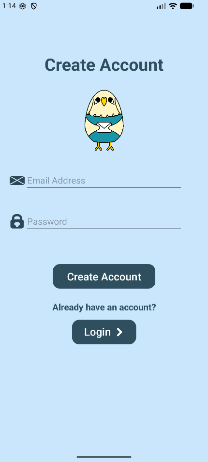 | 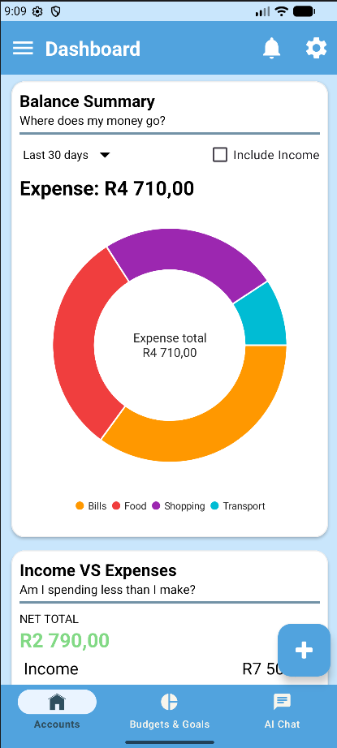 | 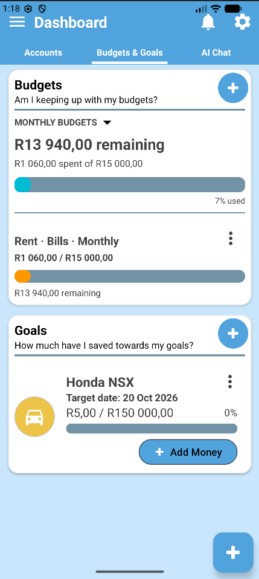 |

| Transactions | Cash Flow | AI Assistant |
|:---:|:---:|:---:|
| 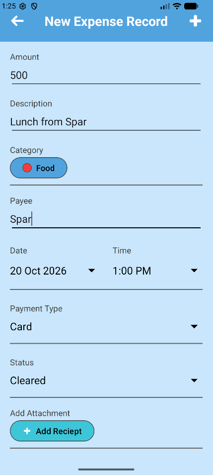 | 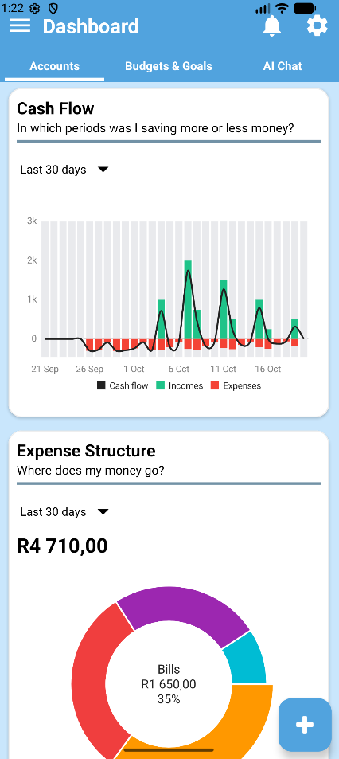 | 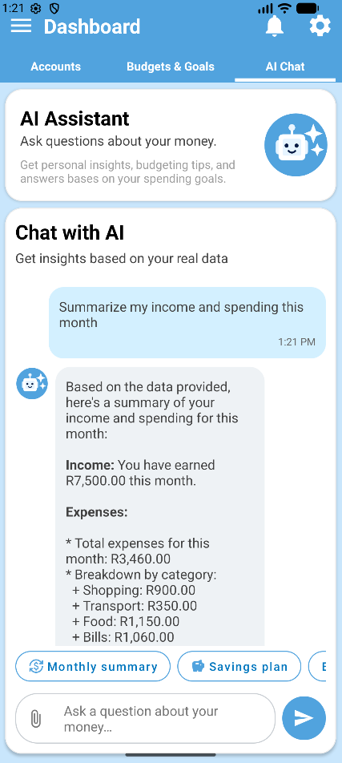 |

---

## 4. Design Considerations

### 4.1 Simplicity first
The interface prioritises clarity and ease of navigation. Information is shown in widgets that use either graphs or short numbers, with brief descriptions so users understand their data at a glance.

### 4.2 Consistent navigation
A persistent footer gives access to **Home, Budget, Transactions** and **Settings** from every screen. A header holds the user's profile, notifications and the AI assistant button.

### 4.3 Visual feedback
Progress bars switch between green and red depending on whether the user is under or over their limit, so overspending is obvious without reading numbers.

### 4.4 Envelope-style budgeting
Funds are allocated to categories such as Groceries, Bills and Transport. This encourages spending discipline by making each category's limit visible.

### 4.5 Personalised AI, not a generic chatbot
The assistant has context about the user's budget, limits and spending trends, so its answers are tailored. Responses are framed as recommendations rather than guaranteed financial advice.

### 4.6 Security and privacy
Users can only access their own financial data. The AI assistant is limited to the authenticated user's information.

### 4.7 Design process
We began with mock-ups of every screen and a navigation flow before writing any code.

| Planned (mock-up) | Final (app) |
|:---:|:---:|
| 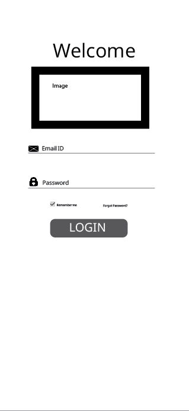 |  |
| 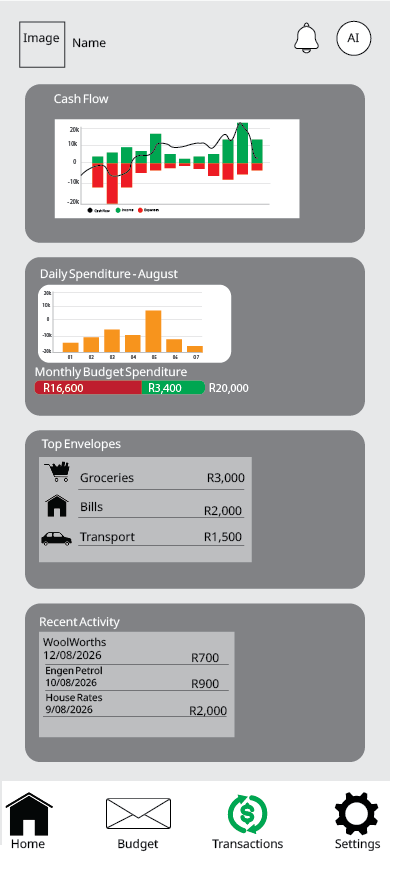 |  |
| 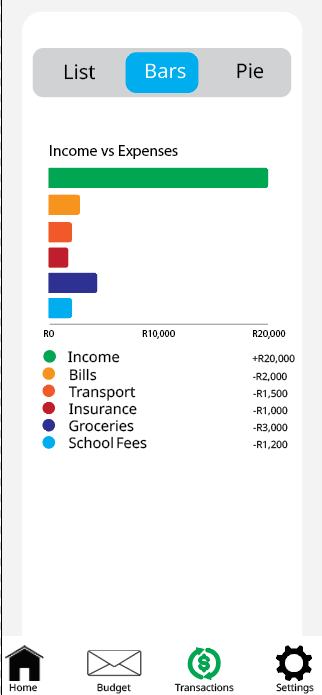 | 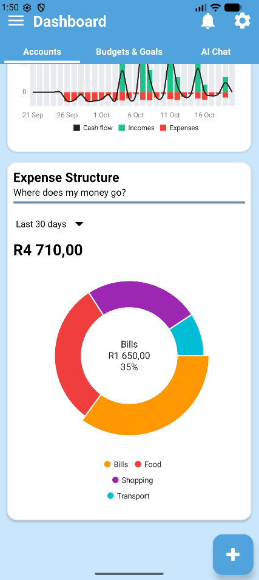 |

---

## 5. Tech Stack

<!-- TODO: confirm and edit this table to match what you actually used -->

| Area | Technology |
|---|---|
| Platform | Android |
| Language | Kotlin |
| IDE | Android Studio |
| Authentication | Firebase Authentication |
| Database | Firebase (Cloud Firestore) |
| AI Assistant | LLM (Ollama, llama 3.2) |
| Charts | TODO: library used for the graphs |
| CI/CD | GitHub Actions |

---

## 6. Using GitHub and GitHub Actions

### 6.1 How we used GitHub

- **Version control:** all code lives in this repository so every change is tracked.
- **Branching:** Our most recent working build would remain on the main branch and other teammates would make use of other branches for adding new features.
- **Commits:** Commits involved the main topic of the commit (what feature it was for) and the progress of it at the time of the commit.
- **Pull requests / code review:** Before merging to main the branch code would be tested to ensure its stability.

### 6.2 How we used GitHub Actions

GitHub Actions automates checks every time code is pushed, so problems are caught early instead of at hand-in time.

<!-- TODO: paste your real workflow file path and explain it -->

**Workflow file:** `.github/workflows/TODO.yml`

| Step | What it does |
|---|---|
| Trigger | TODO e.g. runs on every push and pull request to `main` |
| Set up | TODO e.g. checks out code, sets up JDK |
| Build | TODO e.g. builds the app with Gradle |
| Test | TODO e.g. runs unit tests |

<!-- TODO: add a screenshot of a green workflow run from the Actions tab -->


**Why this matters:** TODO 2-3 sentences on the benefit to your team (catching build errors, consistency, saving time).

---

## 7. Getting Started

<!-- TODO: confirm these steps work on a clean machine -->

### Prerequisites
- Android Studio Version ()
- Android device or emulator min SDK 34
- A Firebase project (TODO or explain how to use ours)

### Setup
```bash
# 1. Clone the repository
git clone https://github.com/Fate2664/BudgieApp_OSC

# 2. Open the project in Android Studio

# 3. Add your google-services.json to the app/ folder

# 4. Sync Gradle and run the app
```

### AI assistant setup
<!-- TODO: explain how the LLM is set up/run so a marker could use it -->

---

## 8. Project Planning

Our project followed a plan covering research, design, development and refinement.

<!-- TODO: add your Gantt chart image -->
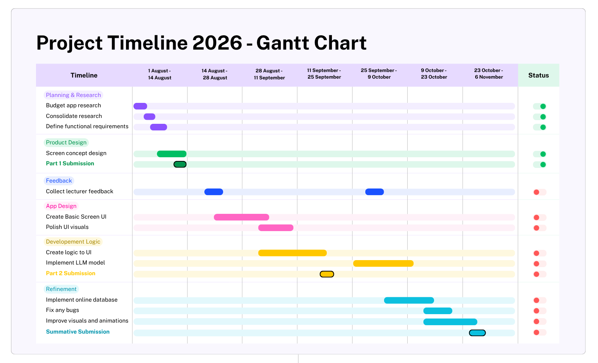

---

## 9. Team

| Name | Student Number |
|---|---|
| Nicholas Smart | ST10433819 |
| Craig Harrod | ST10451648 |
| Kaellum Alves | ST10440806 |
| Pierre Louw | ST10437081 |

---

## 10. References

- Hypertext, 2024. *22seven is now Vault22, offering financial wellness to all.* https://htxt.co.za/2024/11/22seven-is-now-vault22-offering-financial-wellness-to-all/
- Goodbudget. *About us.* https://goodbudget.com/about-us/
- Schwahn, L., 2026. *What Is Cash Stuffing? How to Use the Envelope Budget System.* NerdWallet. https://www.nerdwallet.com/finance/learn/envelope-system
- Wait, R., 2025. *Wallet by BudgetBakers review.* Finder. https://www.finder.com/uk/budgeting/wallet-budgetbakers-review
- Budgetbakers, 2026. *What is the Wallet app?* https://support.budgetbakers.com/hc/en-us/articles/12212428113810-What-is-the-Wallet-app

<!-- TODO: add the rest of your Part 1 references plus anything new (Firebase docs, charting library, etc.) -->

---

<div align="center">
Made by the Budgie team 🐦
</div>
